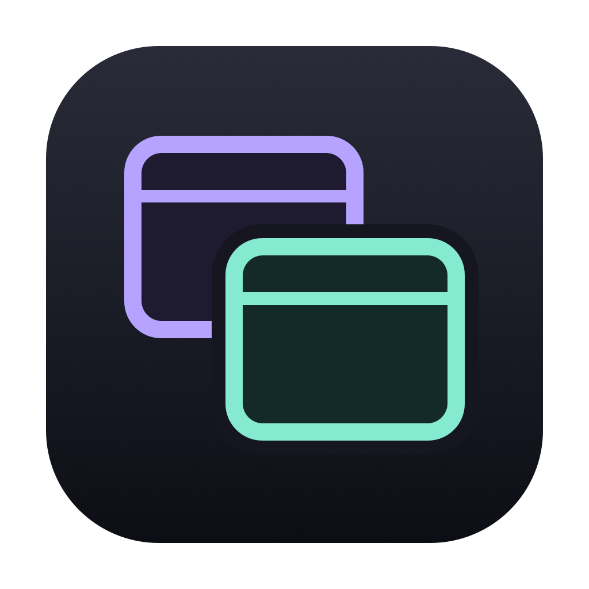
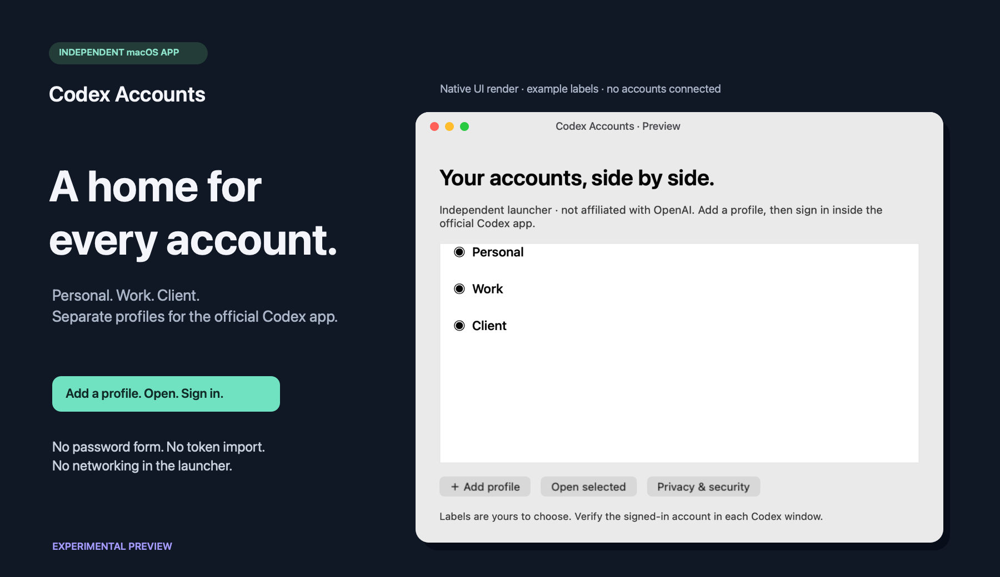
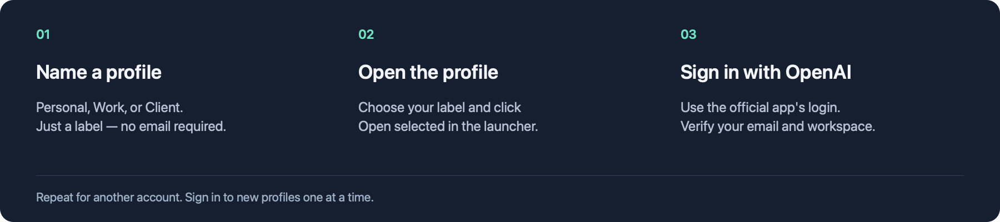

<p align="center">
  
</p>
<h1 align="center">Codex Accounts</h1>
<p align="center"><strong>A home for every account.</strong><br>Separate profiles for the official Codex desktop app on macOS.</p>
<p align="center">
  <a href="https://github.com/dngns/codex-accounts/actions/workflows/build.yml"></a>
  <a href="LICENSE"></a>
  
</p>
<p align="center">
  <a href="https://github.com/dngns/codex-accounts/releases/tag/v0.1.2-preview.1"></a>
</p>
<p align="center">
  <a href="#get-started">Get started</a> · <a href="#your-login-stays-with-the-official-app">Privacy</a> · <a href="docs/TECHNICAL.md">Technical docs</a> · <a href="docs/README.vi.md">Tiếng Việt</a>
</p>

> [!IMPORTANT]
> **Experimental preview · independent of OpenAI.** The download is not notarized and macOS may block it. [Read the release notes](https://github.com/dngns/codex-accounts/releases/tag/v0.1.2-preview.1) before downloading. Do not disable Gatekeeper to run it.


<p align="center"><sub>Rendered from the app's native interface with example labels. No real accounts are connected or shown.</sub></p>

### Personal. Work. Client. One small launcher.

Keep a separate place for each account without repeatedly swapping the default profile. Add a label, open the profile, and sign in inside the official app.

| Separate profiles | Familiar sign-in | Small by design |
| :--- | :--- | :--- |
| A dedicated Codex home and desktop data folder for every profile. | Use the official OpenAI sign-in flow. The launcher has no password form. | Native Swift app. No Node, Python, Homebrew, or Terminal needed to use a packaged build. |

## Get started



1. **Install the official Codex desktop app** from OpenAI, then download and unzip this launcher.
2. **Add a profile** such as Personal or Work. Select it and click **Open selected**.
3. **Sign in inside the official app.** Verify the email and workspace, then repeat for another account. Sign in to new profiles one at a time.

You can move **Codex Accounts.app** into Applications. This launcher does not import or change your existing default account.

## Download

| Package | Platform | Download |
| :--- | :--- | :--- |
| **0.1.2 Preview · Universal ZIP** | macOS 13+ · Apple Silicon and Intel build targets | [Download app](https://github.com/dngns/codex-accounts/releases/download/v0.1.2-preview.1/Codex-Accounts-preview-universal.zip) |
| **SHA-256 checksums** | Verify archive integrity | [Download SHA256SUMS](https://github.com/dngns/codex-accounts/releases/download/v0.1.2-preview.1/SHA256SUMS) |

**Before you install:** the official Codex app is required. This preview is ad-hoc signed, not Developer ID signed or notarized. Intel runtime, full multi-account login, and clean-Mac download acceptance are still pending. [Validation record →](VALIDATION.md)

<details>
<summary><strong>macOS blocked the app — what should I do?</strong></summary>

Keep macOS protections enabled. Wait for a future Developer ID signed and notarized release, or build from reviewed source on your own Mac. We do not recommend disabling Gatekeeper or removing quarantine. A frictionless downloaded double-click release is not available yet.

</details>

## Your login stays with the official app

| What the launcher does | What it never asks for |
| :--- | :--- |
| Creates private folders and stores profile labels. | Your password, API key, or pasted access token. |
| Verifies the official app's signature before opening it. | Permission to read or copy existing credentials. |
| Uses local system APIs, with no built-in networking or telemetry. | An account on a separate launcher service. |

The official app handles authentication and stores sensitive account data locally. **Separate profiles are not an OS security boundary:** software running as the same macOS user may still access that data. Open source and signatures are not an account-theft guarantee.

[Read the security model](SECURITY.md) · [Inspect the source](Sources) · [Report a vulnerability privately](https://github.com/dngns/codex-accounts/security/advisories/new)

## Common questions

<details>
<summary><strong>Can I use personal, company, or custom-domain accounts?</strong></summary>

The launcher has no email or domain filter. Sign-in eligibility, SSO, workspace access, and organization restrictions remain controlled by OpenAI and your organization. A profile label is not proof of the signed-in account. Verify the email and workspace in the official window.

</details>

<details>
<summary><strong>Where are my profiles stored?</strong></summary>

Under `~/Library/Application Support/Codex Accounts/`. Each profile gets a random UUID directory with its own `home` and `app-data`. Launcher-created directories are private (`0700`), and files are `0600`. Credentials and account data written by the official app remain sensitive; never share or commit those folders. [Storage details →](docs/TECHNICAL.md#where-is-my-data)

</details>

<details>
<summary><strong>Will existing accounts or custom launchers change?</strong></summary>

No existing default or custom profile is imported or modified. Existing launcher files stay as they are. Removing this app does not erase profile data or sign you out; sign out in the official app before retiring a profile.

</details>

<details>
<summary><strong>Is this an official OpenAI feature?</strong></summary>

No. This is an independent, experimental launcher, not affiliated with or endorsed by OpenAI. Its desktop launch mechanism is based on the installed app's behavior, not a published multi-account compatibility promise. Future updates may change behavior, and re-login may be required. [Compatibility details →](docs/TECHNICAL.md#compatibility)

</details>

## Build, inspect, contribute

Requires macOS and Xcode Command Line Tools for development. End users of a packaged build do not need a toolchain.

```sh
bash scripts/test.sh
bash scripts/build.sh
```

[Build and signing details](docs/TECHNICAL.md#build-and-test) · [Artwork reproduction](docs/SHOWCASE.md) · [Release checklist](docs/RELEASING.md) · [Report a bug](https://github.com/dngns/codex-accounts/issues/new)

## License & independence

Project code, docs, and original artwork are **[MIT licensed](LICENSE)** where applicable. The icon and showcase are created within this project; no stock image, OpenAI logo, third-party icon pack, or bundled font is used.

[Artwork provenance and licensing](LICENSING.md) · [Third-party inventory](THIRD_PARTY_NOTICES.md)

Codex, OpenAI, and ChatGPT identify the compatible third-party product. Their trademarks are not licensed by this project. This launcher is independent and not endorsed by OpenAI; the licensing review is not a guarantee against intellectual-property claims.
