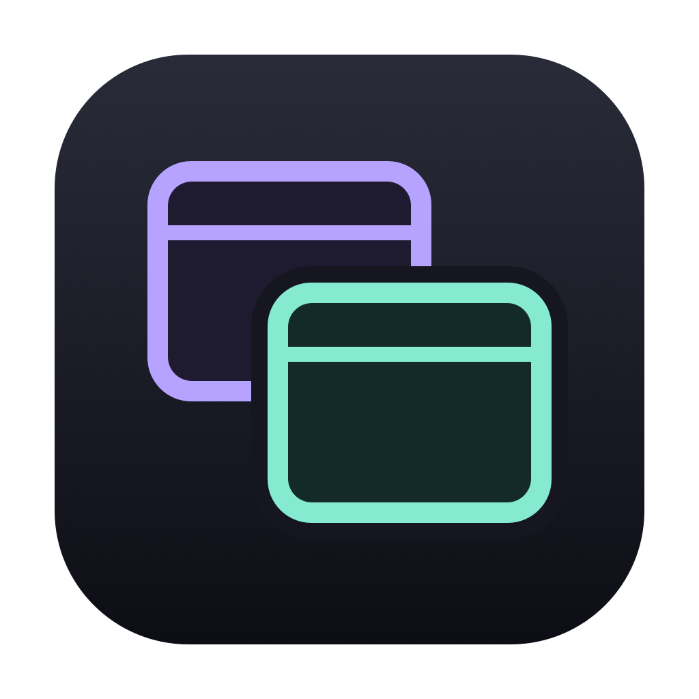
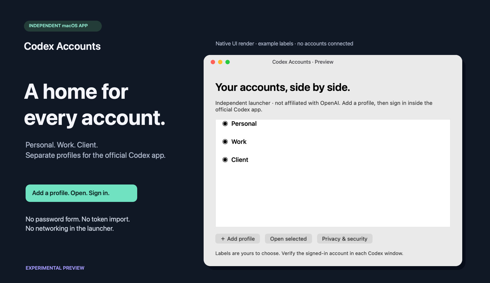

  

<h2 align="center">Two windows. One launcher.</h2>

Codex Accounts 0.1.2 Preview · Native macOS launcher · Independent of OpenAI

## Download for macOS

One universal app package for Apple Silicon and Intel build targets. Requires macOS 13+ and the official Codex desktop app, installed separately.

| File | For | Download |
| :--- | :--- | :--- |
| **Codex Accounts.app · ZIP** | Use the launcher | [Download universal preview](https://github.com/dngns/codex-accounts/releases/download/v0.1.2-preview.1/Codex-Accounts-preview-universal.zip) |
| **SHA256SUMS** | Verify archive integrity | [Download checksums](https://github.com/dngns/codex-accounts/releases/download/v0.1.2-preview.1/SHA256SUMS) |

> [!IMPORTANT]
> **Preview, not notarized.** This package is ad-hoc signed, not Developer ID signed. macOS may block the download. Keep Gatekeeper enabled; do not remove quarantine to run it. A frictionless downloaded double-click release is still pending.

**Choose the ZIP above to get the app.** The “Source code” archives under Assets are for developers.

## Get started

1. Unzip the download and open **Codex Accounts.app**. You may move it to Applications.
2. Choose **Add profile**, enter a label, then select it and click **Open selected**.
3. Sign in through the official app and verify the email/workspace. Repeat for another account, one sign-in at a time.

## What's new in 0.1.2

- **A cleaner app icon.** Two overlapping window outlines in lavender and mint on a graphite background replace the account-card illustration.
- **Clear at small sizes.** All ten macOS icon representations are regenerated, from 16px to 1024px, and packaged in the app's ICNS resource.
- **Artwork you can inspect.** Editable SVG, PNG preview, and project-authored drawing code remain available under the project's MIT terms where applicable.

The launcher still creates separate profile folders, verifies the selected official app's signature, and leaves authentication to that app. It has no built-in networking, telemetry, password form, or token import.

<strong>Verification and current limits</strong>

| Checked | Result |
| :--- | :--- |
| Isolation/security checks | 23 passing automated checks |
| App package | Universal binary and ad-hoc signature verified |
| Artwork | Ten PNG icon sizes and ICNS structure inspected |
| Release archive | Downloaded from GitHub; SHA-256 matched |
| Full multi-account login, Intel runtime, clean-Mac download acceptance | Still pending |

Profiles share one macOS user and are not an OS security boundary. Credentials stored by the official app remain sensitive. Account eligibility, SSO, and organization policies still apply. Desktop launch flags are internal behavior and may change.

The showcase is a source-derived native UI render with fixture labels, not proof of connected accounts. No OpenAI logo or external artwork is bundled. The licensing review is not legal clearance or an absolute non-infringement guarantee.

---

[Source at this version](https://github.com/dngns/codex-accounts/tree/v0.1.2-preview.1) · [Changes since 0.1.1](https://github.com/dngns/codex-accounts/compare/v0.1.1-preview.1...v0.1.2-preview.1) · [Security](https://github.com/dngns/codex-accounts/blob/main/SECURITY.md) · [Licensing](https://github.com/dngns/codex-accounts/blob/main/LICENSING.md) · [Validation](https://github.com/dngns/codex-accounts/blob/main/VALIDATION.md)
