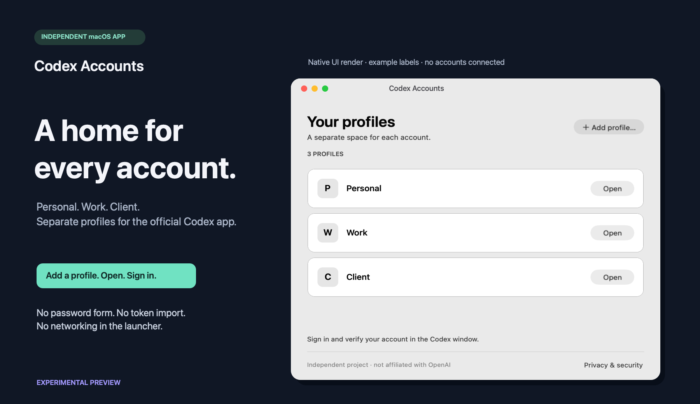
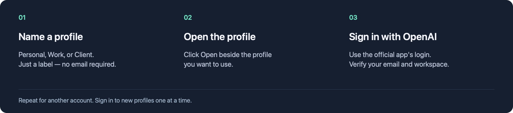

# Codex Accounts

[English](../README.md) · [Tải bản preview](https://github.com/dngns/codex-accounts/releases/tag/v0.1.4-preview.1)

**Mỗi tài khoản một profile riêng.** Launcher nhỏ cho macOS, dùng cùng ứng dụng Codex chính thức.

*Hình render từ giao diện native với dữ liệu minh họa; không hiển thị tài khoản thật.*

> [!IMPORTANT]
> Đây là bản thử nghiệm độc lập, không được OpenAI bảo trợ. App chưa được ký Developer ID hoặc notarize, nên macOS có thể chặn bản tải xuống. Không tắt Gatekeeper hoặc xóa quarantine để chạy bản thử.

## Bắt đầu trong 3 bước

1. Cài app Codex chính thức từ OpenAI. Tải và giải nén launcher từ [Releases](https://github.com/dngns/codex-accounts/releases/tag/v0.1.4-preview.1).
2. Mở **Codex Accounts.app** → **Add profile**, đặt tên như Personal hoặc Work → nhấn **Open** cạnh profile đó.
3. Đăng nhập trong app chính thức, kiểm tra email/workspace. Lặp lại cho tài khoản khác; đăng nhập lần lượt từng profile mới.

| Tải về | Dành cho |
| --- | --- |
| [App dạng Universal ZIP](https://github.com/dngns/codex-accounts/releases/download/v0.1.4-preview.1/Codex-Accounts-preview-universal.zip) | macOS 13+; có binary Apple Silicon và Intel |
| [SHA256SUMS](https://github.com/dngns/codex-accounts/releases/download/v0.1.4-preview.1/SHA256SUMS) | Kiểm tra tính toàn vẹn file tải xuống |

Intel runtime, toàn bộ luồng đăng nhập nhiều tài khoản và tải/mở trên máy Mac sạch vẫn cần kiểm thử thêm. Xem [ghi nhận kiểm thử](../VALIDATION.md).

## Tài khoản có an toàn không?

Launcher không có form mật khẩu, không đọc/copy token và không có networking hay telemetry. Nó tạo thư mục profile, lưu nhãn và kiểm tra chữ ký app OpenAI trước khi mở. App chính thức xử lý đăng nhập và lưu dữ liệu nhạy cảm tại máy.

Các profile cùng user macOS **không phải ranh giới bảo mật của hệ điều hành**. Malware hoặc phần mềm khác chạy cùng user có thể truy cập dữ liệu đăng nhập. Mã nguồn mở và chữ ký không phải cam kết chống đánh cắp tài khoản tuyệt đối. Không chia sẻ thư mục profile, token hay log chứa dữ liệu riêng tư.

[Mô hình bảo mật](../SECURITY.md) · [Mã nguồn](../Sources) · [Báo cáo lỗ hổng riêng tư](https://github.com/dngns/codex-accounts/security/advisories/new)

## Những điều cần biết

- Không lọc email/domain. Quyền đăng nhập, SSO và workspace vẫn theo OpenAI và chính sách tổ chức.
- Không nhập hay thay đổi tài khoản mặc định hoặc các launcher có sẵn.
- Dữ liệu mới nằm ở `~/Library/Application Support/Codex Accounts/`, mỗi profile dùng UUID riêng.
- Xóa launcher không tự xóa dữ liệu hoặc đăng xuất tài khoản. Đăng xuất trong app chính thức khi ngừng dùng một profile.
- Cơ chế mở nhiều profile dựa trên hành vi bản app đã kiểm tra; các bản cập nhật sau có thể thay đổi hoặc yêu cầu đăng nhập lại.

## Giấy phép và tài liệu

Mã nguồn, tài liệu và artwork riêng của dự án được cấp phép [MIT](../LICENSE) trong phạm vi quyền áp dụng. Không dùng logo OpenAI, ảnh stock, bộ icon bên ngoài hay font đóng gói. Tên sản phẩm và nhãn hiệu của bên thứ ba không thuộc giấy phép MIT này.

[Nguồn gốc artwork và rà soát giấy phép](../LICENSING.md) · [Thành phần bên thứ ba](../THIRD_PARTY_NOTICES.md) · [Tài liệu kỹ thuật](TECHNICAL.md)
